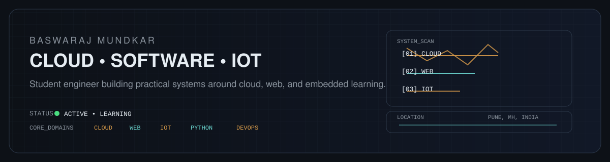

  <picture>
    <source media="(prefers-color-scheme: dark)" srcset="assets/hero-dark.svg">
    <source media="(prefers-color-scheme: light)" srcset="assets/hero-light.svg">
    
  </picture>

  <a href="https://www.linkedin.com/in/baswaraj-mundkar-796ba4405/">LinkedIn</a> ·
  <a href="https://github.com/Baswaraj-Mundkar">GitHub</a>

## About

I'm a BCA student specializing in **Cloud Computing** at Pimpri Chinchwad College of Engineering & Research (PCCOER), Pune (2024–2027).

I'm focused on building my skills in **web development and cloud technologies**—from creating web interfaces and cloud-connected applications to understanding cloud services, deployment, and infrastructure.

- **Based in:** Pune, Maharashtra, India
- **Primary interests:** Web Development · Cloud Computing · Software Development
- **Currently strengthening:** HTML, CSS, JavaScript, Python, Git, and cloud fundamentals

## Technical skills

| Area | Technologies |
|---|---|
| Web development | HTML, CSS, JavaScript |
| Programming | Python, Java, C, C++ |
| Backend and data services | Firebase, Cloud Firestore |
| Cloud | AWS and Azure fundamentals; cloud concepts and services |
| Tools | Git, GitHub, VS Code |

  

## Projects

### [DrishtiX — Misinformation awareness web application](https://github.com/Baswaraj-Mundkar/DrishtiX)

A web application that helps users examine suspicious claims and learn media-literacy practices.

- Provides a browser-based interface for examining claims.
- Includes heuristic claim analysis and optional Google Fact Check Tools API lookup.
- Provides report submission, a dashboard, and a Leaflet-based map interface.
- Includes learning resources and quizzes in eight Indian languages.

**Tech:** HTML, CSS, JavaScript, SheetJS, Leaflet.

### [BhoomiFi — Cloud-connected IoT dashboard](https://github.com/Baswaraj-Mundkar/Bhoomifi)

A smart-irrigation monitoring prototype combining a web dashboard, Firebase/Firestore, and an ESP32 sensor device.

- Uses Firebase Authentication and Firestore for owner/device identity and telemetry.
- Connects sensor readings and device state to a Next.js dashboard.
- Separates simulated demo data from live device telemetry.
- Demonstrates a device-to-cloud data flow and cloud-backed application architecture.

**Tech:** Next.js, Firebase Authentication, Cloud Firestore, ESP32.

*BhoomiFi is a collaborative project. My primary contribution has been the ESP32 hardware, sensor integration, firmware, and device-to-cloud telemetry; the web dashboard and Firebase application work were handled collaboratively. The current firmware is an LED-only prototype and does not operate a pump or relay.*

## Education

**Bachelor of Computer Applications (BCA) — Cloud Computing**  
Pimpri Chinchwad College of Engineering & Research (PCCOER), Pune  
2024–2027

## Current learning focus

- Improving frontend development with HTML, CSS, and JavaScript.
- Strengthening programming fundamentals with Python.
- Learning cloud services, deployment, identity, storage, and infrastructure fundamentals.
- Practising Git-based workflows and writing clear technical documentation.

## Contact

- **LinkedIn:** [linkedin.com/in/baswaraj-mundkar](https://www.linkedin.com/in/baswaraj-mundkar-796ba4405/)
- **GitHub:** [github.com/Baswaraj-Mundkar](https://github.com/Baswaraj-Mundkar)

---

  Web Development · Cloud Computing · Continuous Learning

